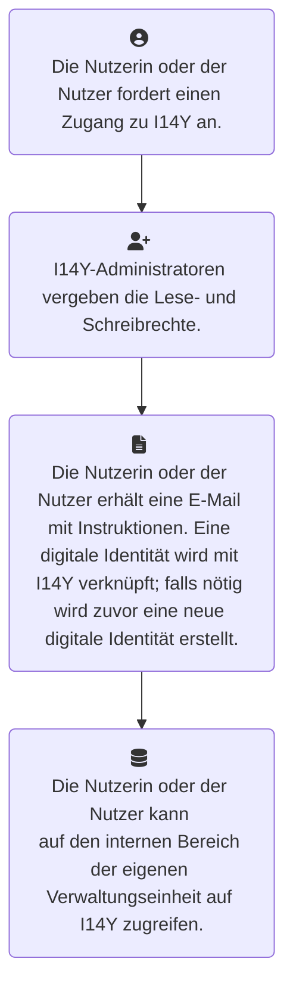

Die Interoperabilitätsplattform I14Y kann ohne Login genutzt werden -- etwa um die öffentlich publizierten Einträge zu durchsuchen. Wer auf I14Y aber Einträge erfassen will, benötigt Schreibrechte. Und wer (noch) nicht öffentlich publizierte Informationen der eigenen Organisation einsehen soll, benötigt Leserechte im organisationsinternen Bereich. Diese Zugänge müssen zuerst geschaffen werden. Nötig ist ein so genanntes _Onboarding_. Dieses beinhaltet zwei zentrale Arbeitsschritte.

__Zugang anfordern:__ Kontaktieren Sie die für den I14Y-Zugang verantwortlichen Personen in Ihrer Organisation. Ist die Kontaktperson nicht bekannt oder gibt es keine solche interne Stelle, kann das [Kompetenzzentrum Datenbewirtschaftung](mailto:i14y@bfs.admin.ch) angeschrieben werden. Erwähnen Sie in Ihrem Antrag, ob Sie Metadaten schreiben oder lediglich lesen müssen. Das organisationsinterne Kontaktstelle oder das I14Y-Team prüft anschliessend Ihre Anfrage. Wenn ein Zugang geschaffen werden soll, weist es Ihnen anschliessend die richtigen Rechte zu: Die _Viewer_-Rolle lässt einzig das Lesen zu, mit der _Submitter_-Rolle können Sie Einträge editieren oder neue erfassen. Als _Local Data Steward_ können Sie Einträge publizieren. 

__Verknüpfen der digitalen Identität mit I14Y:__ Sobald Ihnen die richtigen Rechte zugewiesen worden sind, erhalten Sie eine E-Mail mit Instruktionen zum Onboarding. Kopieren Sie den darin enthaltenen Zahlencode und folgen Sie den Anweisungen. Sie werden -- sofern noch nicht vorhanden -- eine digitale Identität erstellen und diese mittels des Codes mit der Applikation verbinden. I14Y nutzt das _Enterprise Identity and Access Management (EIAM)_, das das Bundesamt für Informatik im Auftrag des Bundes betreibt. Deshalb können Mitarbeitende der Bundesverwaltung sich mit ihrem [Fedlogin](https://www.eiam.swiss) einloggen. Bundesexterne Personen nutzen [AGOV](https://www.agov.swiss) oder einen anderen der zur Auswahl stehenden Identitätsanbieter (z.B. die Switch edu-ID). Falls noch keine passende digitale Identität vorhanden ist, muss eine erstellt werden. 


Damit der Zugriff funktioniert, müssen Sie beim Erstellen der digitalen Identität zwingend jene E-Mail verwenden, an die die Onboarding-Instruktionen geschickt worden sind. Als Beispiel: Erstellen Sie eine AGOV-Identität mit Ihrer geschäftlichen E-Mail-Adresse -- auch wenn Sie privat bereits über eine Identität verfügen. Sollte der Onboarding-Prozess abbrechen, löschen Sie die _Cookies_ im Webbrowser (Tastenkombination `Ctrl-Shift-Löschen`) und versuchen Sie es erneut.



Sobald Sie den Onboarding-Prozess abgeschlossen haben, können Sie sich über das Einwählsymbol oben rechts auf der Startseite von I14Y einloggen -- oder direkt unter [input.i14y.admin.ch](https://input.i14y.admin.ch). Falls Sie nach der einmaligen Einrichtung die hinterlegten Angaben anpassen möchten, besuchen Sie den [Kontoverwaltungsbereich von EIAM](https://www.myaccount.eiam.admin.ch). 

## Kontenverwaltung in grösseren Organisationen 

Grössere Organisationen sind selber für die Verwaltung der Lese- und Schreibrechte zuständig. Sie stellen die nötigen personellen Ressourcen zur Verfügung. Je nach Situation können die Arbeitsschritte zum Eröffnen eines Kontos variieren.

Die Lese- und Schreibrechte werden in der Regel über das [Portal zum Delegierten Management](https://www.portal.eiam.admin.ch/) vergeben. Falls Sie für die Verwaltung der Zugriffsrechte verantwortlich sind und noch keinen Zugriff auf dieses Portal haben, nehmen Sie mit dem [Kompetenzzentrum Datenbewirtschaftung](mailto:i14y@bfs.admin.ch) Kontakt auf. Um als Rechteverwalterin oder -verwalter neuen Mitarbeitenden Zugang zur Plattform zu geben, gehen Sie wie folgt vor: 

1. Besuchen Sie das Portal zum Delegierten Management. Wählen Sie im Reiter "Benutzermanagement" den Punkt "Delegiertes Management" aus. Klicken Sie auf den Namen Ihrer Organisation. Ein Klick auf "Weiter" ganz unten rechts öffnet die Detailansicht mit der Liste der Zugangsberechtigten. Sollte Ihre Organisation noch nicht bestehen, nehmen Sie mit dem Kompetenzzentrum Datenbewirtschaftung Kontakt auf.
2. Klicken Sie auf "Personenauswahl", falls die betreffende Person bereits bei eIAM registriert ist, geben Sie die E-Mail-Adresse ein und rufen Sie die Informationen ab. Alternativ klicken Sie auf "Neuen Benutzer hinzufügen". Füllen Sie die Felder Name, Vorname und E-Mail-Adresse aus. Verwenden Sie die E-Mail-Adresse, mit der sich die Person beim Identitätsanbieter (Fedlogin oder AGOV) registriert hat oder mit der sie sich registrieren soll; in der Regel wird die geschäftliche E-Mail-Adresse genutzt. Bestimmen Sie zudem, in welcher Sprache die Onboarding-Informationen verschickt werden sollen. Die weiteren Felder sind optional. Sie werden von I14Y nicht verwendet.
3. Wählen Sie die neu erfasste Person aus. Klicken Sie auf "Weiter". Nun werden Sie dazu aufgefordert, die Zugriffsberechtigungen zu vergeben. Passen Sie zuerst den Namen des Profils an: Klicken Sie dazu auf das Bleistiftsymbol links. Ersetzen Sie den Namen durch eine aussagekräftige Beschreibung und ersetzen Sie die Nummer durch die vorne ersichtliche Profil-ID. Bewährt haben sich Beschreibungen wie "LocalDataSteward-1159123", "Submitter-1159123" oder "Viewer-1159123". Tragen Sie im Eingabefeld darunter das Zeichen * ein. Klicken Sie auf "Speichern".
4. Wählen Sie unter "Geschäftsrollen" die passende Rolle aus. In der Regel wird dort _StewardshipOrganizationViewer_ (ausschliesslich Lesezugriff) oder _Submitter_ (Rechte zur Erfassung von Metadaten, nicht aber zur Publikation) angewählt. Falls Sie _Local Data Steward_-Rechte vergeben müssen, wenden Sie sich bitte an das Kompetenzzentrum Datenbewirtschaftung, da nur dieses diese weitgehenden Rechte zuweisen kann. Fügen Sie mit einem Klick auf den Knopf "Berechtigen" die entsprechenden Schreib- und Leserechte dem Profil hinzu. Klicken Sie schliesslich auf "Weiter". __Achtung:__ Jedem Profil sollte nur eine Rolle zugewiesen werden. Es ist aber möglich, für ein Konto mehrere Profile zu eröffnen. Klicken Sie dazu auf den entsprechenden Link. In diesem Fall muss die betreffende Person beim Einloggen jeweils auswählen, mit welchem Profil sie sich anmelden möchte.   
5. Beschreiben Sie das neue Konto kurz. Verschicken Sie schliesslich mit einem Klick auf "Benachrichtigungs-E-Mail senden" die Onboarding-Nachricht an die betreffende Person. In der Nachricht wird diese aufgefordert, auf einen Link zu klicken und einen mitgeschickten Code in ein Webformular einzutragen. Damit werden der digitalen Identität die nötigen Lese- und Schreibrechte zugewiesen. Auf der Übersicht des Portals zum Delegierten Management sehen Sie jederzeit, welche Personen das so genannte Onboarding erfolgreich abgeschlossen haben.